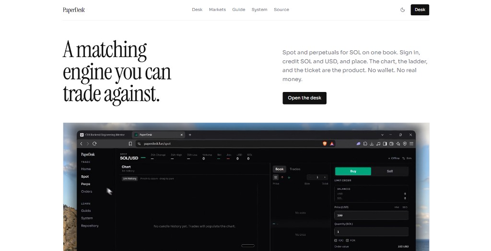

# PaperDesk

**A matching engine you can trade against.**

Spot and perpetuals for SOL on one book. Sign in, credit SOL and USD, and place. The chart, the ladder, and the ticket are the product. No wallet. No real money.

[](https://paperdesk.fun)

<p align="center">
  <a href="https://paperdesk.fun"></a>
  <a href="https://gateway.paperdesk.fun"></a>
  <a href="https://github.com/ParthKadam11/PaperDesk"></a>
</p>

<p align="center">
  
  
  
  
  
  
  
  
  
  
  
  
  
  
  
  
  
  
  
  
  
</p>

---

It is a systems product:

- a **single-writer matching engine** with WAL + snapshots
- an **asynchronous OMS** with a transactional outbox
- a **gateway** that translates Redis Streams and exchange SSE
- a separate **TimescaleDB ingester** for history
- **spot + perps** in-process (mark, liquidation, funding)

Built so failure modes stay visible — duplicate commands, maker/taker fills, reconnect gaps, crash windows between engine execution and event publication — instead of hiding them behind one CRUD API.

---

## Engine benchmarks

Measured on Contabo VPS `vmi3586283` · **4 CPUs · 7.8 GiB** · Linux 6.8 · Node 20 (showcase suite: `pnpm bench:showcase`). Full artifact: [`scripts/bench/showcase-last-run.json`](scripts/bench/showcase-last-run.json).

### Headline

| Metric | Result |
| --- | ---: |
| In-process matches | **67,547 /s** (~14.8 µs / match) |
| Book inserts | **651,527 /s** |
| HTTP place+cancel peak | **511.5 place/s** (128 VUs, 0% errors) |
| Crash recovery | **3 ms** · book + balances + orders match |

### In-process matcher

Pure `MatchingEngine` + `OrderBook` in one Node process. **No HTTP, Redis, Postgres, or WAL.**

| Workload | Ops | Time | Throughput |
| --- | ---: | ---: | ---: |
| Book adds | 500,000 | 767.4 ms | **651,527 /s** (~1.5 µs / op) |
| Crossing takers | 1,000,000 | 14.8 s | **67,547 matches/s** |

```bash
pnpm bench:matcher
```

### HTTP place + cancel (k6 → exchange API)

Isolated exchange on a clean data dir (`SLEEP=0`). Place + cancel loop; far-from-market limits so the book does not accidentally match.

| VUs | Place/s | p50 | p95 | p99 | Errors |
| ---: | ---: | ---: | ---: | ---: | ---: |
| 8 | 160.7 | 21 ms | 46 ms | 89 ms | 0% |
| 64 | 433.2 | 60 ms | 150 ms | 285 ms | 0% |
| 128 | **511.5** | 104 ms | 298 ms | 375 ms | 0% |

```bash
VUS=128 DURATION=20s SLEEP=0 pnpm bench:latency
```

HTTP latency is dominated by WAL fsync + process boundaries — not the matcher. Use the in-process numbers for core engine speed; use k6 for end-to-end API capacity.

### Crash recovery

`SIGKILL` → restart against the same WAL/snapshot dir → assert book, balances, and open orders match.

| Metric | Result |
| --- | ---: |
| Time to `/health/live` | **3 ms** |
| State match | **yes** |

```bash
pnpm bench:recovery
# or the full screenshot suite:
pnpm bench:showcase
```

---

## Tech stack

| Layer | Technologies |
| --- | --- |
| Language & monorepo |     |
| HTTP services |  `@hono/node-server` · `tsx` |
| Web desk |     TradingView Lightweight Charts |
| Messaging & state |  Exchange WAL + snapshots on disk |
| Data |    |
| Ops |    Let’s Encrypt |
| Observability |   Loki |
| Quality |    |

### Apps

| App | Role | Stack |
| --- | --- | --- |
| **exchange** | Single-writer matcher, balances, WAL, HTTP/SSE | Hono · in-memory book · file WAL |
| **engine-gateway** | Sole engine client; Redis ↔ HTTP/SSE bridge | Hono · ioredis |
| **oms** | Durable order projection + command outbox | Hono · Prisma · Postgres · Redis |
| **ingester** | History writer (trades, BBO, candles) | Hono · TimescaleDB · Redis |
| **web** | Trading desk + Google auth + paper credit | Next.js 16 · React 19 · Auth.js |

Package names are still `@cex/*`. **PaperDesk** is the product name.

---

## What makes it different

- Engine owns matching and balances; OMS is a durable projection, not a second matching engine
- Place/cancel uses Redis Streams + Postgres outbox instead of synchronous “write DB and hope”
- Maker and taker fills share a trade id but are stored per order; events carry engine sequence
- Live market data is ephemeral (pub/sub); history is durable (`md:events` → Timescale)
- Perps add margin, positions, mark, liquidation, and funding on the same engine model
- SSE reconnect uses `streamSeq` catch-up, with reconcile when the in-memory ring was overrun
- Browser market streams can EventSource the gateway directly (ticket from the web BFF)

---

## Architecture

```text
apps/web
  └─ Google auth + Spot / Perps desk + charts

apps/exchange
  └─ matching engine + balances + WAL + snapshots + HTTP/SSE

Application layer
  └─ OMS → engine-gateway → exchange
  └─ Redis Streams + Redis pub/sub
  └─ exchange SSE → engine-gateway → md:events + orders:events
  └─ md:events → ingester → TimescaleDB
```

### Exchange engine

Intentionally single-writer per market. Matching stays in memory; disk is for crash recovery.

- `MarketRuntime` — live commands, WAL persistence, replay, checkpoints
- `CommandQueue` — serializes concurrent commands and batches WAL flushes
- `FileWal` — appends `CREDIT`, `PLACE`, `CANCEL`, `LIQUIDATE`, `FUNDING`
- Snapshots — shorten restart by restoring state and replaying only the WAL tail
- `EventBus` — live `ORDER`, `BBO`, `CREDIT`, `TRADE`, `POSITION`, `LIQUIDATION`, `FUNDING` over SSE
- SSE — monotonic `streamSeq` + bounded ring; reconnect via `?afterSeq=` / `Last-Event-ID`
- On SSE `gap`, gateway calls `GET /v1/markets/:market/reconcile` and republishes to `orders:events`

### Application layer

- Redis Streams for command/event delivery between OMS and the engine gateway
- Exchange SSE as the canonical source for BBO, trades, and maker-side fills
- Redis pub/sub for live best bid/ask and trade fan-out
- Durable `md:events` + TimescaleDB for historical market data
- Postgres for users and OMS order state — trading balances stay in the exchange WAL

---

## Monorepo layout

```text
PaperDesk/
├── apps/
│   ├── exchange/
│   ├── engine-gateway/
│   ├── ingester/
│   ├── oms/
│   └── web/
├── docs/
│   └── paperdesk-hero.png
├── infra/                 # Redis, Postgres, Timescale, Prometheus, Grafana, Loki
├── scripts/bench/         # matcher · k6 · crash recovery · showcase
├── packages/
│   ├── app-contracts/
│   ├── db/                # Prisma (users + OMS)
│   ├── exchange-types/
│   ├── logger/
│   └── typescript-config/
├── ecosystem.config.cjs   # PM2
└── .github/workflows/     # CI + SSH deploy
```

---

## Prerequisites

- Node.js `>=20` (engines prefer `22.x`)
- pnpm `10.x` (`corepack enable`)
- Docker (Redis / Postgres / Timescale)
- Optional for benches: [k6](https://k6.io/docs/get-started/installation/)

## Local quickstart

```bash
pnpm install
pnpm infra:up
pnpm setup:local          # creates .env files if missing + migrate deploy
```

Edit `apps/web/.env`:

- `GOOGLE_CLIENT_ID` / `GOOGLE_CLIENT_SECRET`
- `NEXTAUTH_SECRET`
- `NEXTAUTH_URL=http://localhost:3000`

```bash
pnpm dev:stack
```

Open [http://localhost:3000](http://localhost:3000). Sign in with Google.

Sim controls and the book wipe are limited to emails in `SIM_OPERATOR_EMAILS` (see [`.env.example`](.env.example)). PM2 turns the shared sim on with `SIM_HEARTBEAT=true`.

| Command | What it starts |
| --- | --- |
| `pnpm infra:up` | Redis `:6379`, Postgres `:5432`, Timescale `:5434` |
| `pnpm setup:local` | Env templates + `prisma migrate deploy` |
| `pnpm dev:stack` | All app processes |
| `pnpm dev:backend` | Without Next.js |
| `pnpm dev` | Web only |

Default local tokens live in [`.env.example`](.env.example). `setup:local` never overwrites existing env files.

### Ports

| Service | Port |
| --- | --- |
| Web | `3000` |
| Exchange | `4010` |
| Engine gateway | `4020` |
| OMS | `4030` |
| Ingester | `4040` |
| Redis | `6379` |
| Postgres | `5432` |
| Timescale | `5434` |

### Individual services

```bash
pnpm dev:exchange
pnpm dev:gateway
pnpm dev:oms
pnpm dev:ingester
pnpm dev
```

Exchange hosts both `SOL-USD` and `SOL-USD-PERP` on `:4010` by default. WALs live under `apps/exchange/data/<market>.jsonl`.

```bash
cross-env EXCHANGE_MARKET=SOL-USD pnpm dev:exchange
pnpm dev:exchange:perp   # legacy separate perp process on :4011
```

Engine env:

- `EXCHANGE_MARKETS` — default `SOL-USD,SOL-USD-PERP`
- `EXCHANGE_MARKET` — single-market override
- `EXCHANGE_PORT` — default `4010`
- `EXCHANGE_WAL_PATH` — single-market only
- `EXCHANGE_DATA_DIR` — default `apps/exchange/data`

### Database

```bash
pnpm db:migrate:deploy
pnpm db:migrate
pnpm db:generate
```

### Infra

```bash
pnpm infra:up
pnpm infra:down
pnpm infra:logs
```

See [`infra/README.md`](infra/README.md). Cloud-style split deploy: [`infra/DEPLOY.md`](infra/DEPLOY.md) §2.

### Production shape

| Piece | Role |
| --- | --- |
| Docker Compose | Redis, Postgres, Timescale, Prometheus, Grafana, Loki (loopback) |
| PM2 | exchange, gateway, OMS, ingester, web |
| nginx | TLS + reverse proxy to loopback |
| Let’s Encrypt | Certificates for public hostnames |
| GitHub Actions | CI on push/PR; Deploy SSHs in, builds web, reloads PM2 |

Public surface: HTTPS for the **web UI** and **gateway SSE**. Apps and DBs listen on localhost. Live market streams use a short-lived ticket from the web BFF, then EventSource the gateway origin directly.

Helpers: `pnpm test:ci`, `pnpm typecheck`, `pnpm build:web`, `pnpm pm2:start` / `pm2:reload`. Full steps: [`infra/DEPLOY.md`](infra/DEPLOY.md) §1.

API envelopes, pagination, BFF boundaries: [API.md](API.md).

---

## Exchange API

Mutating and private query APIs require a gateway token.

| Method | Path | Purpose |
| --- | --- | --- |
| `GET` | `/health` | Process health and active markets |
| `POST` | `/v1/markets/:market/credit` | Internal credit |
| `POST` | `/v1/markets/:market/orders` | Place limit or market (`leverage` for perps) |
| `DELETE` | `/v1/markets/:market/orders/:orderId` | Cancel |
| `GET` | `/v1/markets/:market/orders/:orderId` | Fetch one order |
| `GET` | `/v1/markets/:market/orders?userId=&openOnly=` | User orders |
| `GET` | `/v1/markets/:market/balances/:userId` | Engine balances |
| `GET` | `/v1/markets/:market/positions` | Positions + risk (perp) |
| `GET` | `/v1/markets/:market/positions/:userId` | One position |
| `GET` | `/v1/markets/:market/mark` | Mark price |
| `GET` | `/v1/markets/:market/funding` | Funding rate / interval |
| `POST` | `/v1/markets/:market/funding/settle` | Force funding tick |
| `GET` | `/v1/markets/:market/book` | Book snapshot |
| `GET` | `/v1/markets/:market/reconcile` | Gap recovery snapshot |
| `GET` | `/v1/markets/:market/stream?userId=` | Live SSE |

Notable rules:

- Integer-only units
- Spot market buys require `quoteBudget`; perp MARKET orders require `quoteBudget` on both sides
- Perps lock USD margin (`ceil(notional / leverage)`); fills update positions and realize PnL — no SOL delivery
- Maintenance liquidation force-closes underwater perps at mark vs house (`sim-liquidator`)
- Funding settles periodically (demo: 100 bps / 60s); longs pay shorts when rate > 0
- Spot and perps share one wallet; books and positions stay per market
- Place/credit are idempotent on retry (`orderId` / `commandId`)
- Gateway journals command outcome in Redis before publish — crash mid-flight replays deterministically
- `FOK_BUDGET` is market-buy-only fill-or-kill within `quoteBudget`
- Exchange `BalanceStore` + WAL are authoritative for trading balances

---

## Testing

### Exchange

```bash
pnpm test:exchange
pnpm test:exchange:unit
pnpm test:exchange:integration
pnpm test:exchange:e2e
```

Unit → core modules · Integration → replay / durability · E2E → HTTP + restart.

### OMS

```bash
pnpm test:oms
pnpm test:oms:integration
```

Integration needs PostgreSQL, Redis, exchange, gateway, and OMS running.

### Engine benches

```bash
pnpm bench:matcher
pnpm bench:recovery
pnpm bench:latency
pnpm bench:showcase
```

---

## Implemented

- Spot `SOL-USD` + perp `SOL-USD-PERP` in one multi-market process
- Spot balance locking / delivery; perp USD margin + positions + PnL
- Mark price, maintenance liquidation, periodic funding
- WAL + checkpoints + replay (`CREDIT` / `PLACE` / `CANCEL` / `LIQUIDATE` / `FUNDING`; positions in snapshot v2)
- HTTP commands/queries and SSE (order, credit, BBO, trade, position, liquidation, funding)
- Engine gateway multi-market routing; Redis fan-out for POSITION / LIQUIDATION / FUNDING
- OMS order APIs with leverage persistence + idempotency, outbox, event-driven status updates
- Cancel uses conditional status update so a fill race cannot mark a terminal order `CANCEL_REQUESTED`
- TimescaleDB history (trades, BBO, one-minute candles)
- Web: Google auth, paper credit, Spot / Perps desks
- Shared market sim in the web process (`SIM_OPERATOR_EMAILS` gates wipe/controls)
- Gateway refuses new sim writes while the command stream is behind; drops sim commands older than 1.5s
- Prometheus, Grafana, Loki (loopback — [`infra/README.md`](infra/README.md))
- Showcase benches with published numbers in [`scripts/bench/showcase-last-run.json`](scripts/bench/showcase-last-run.json)
